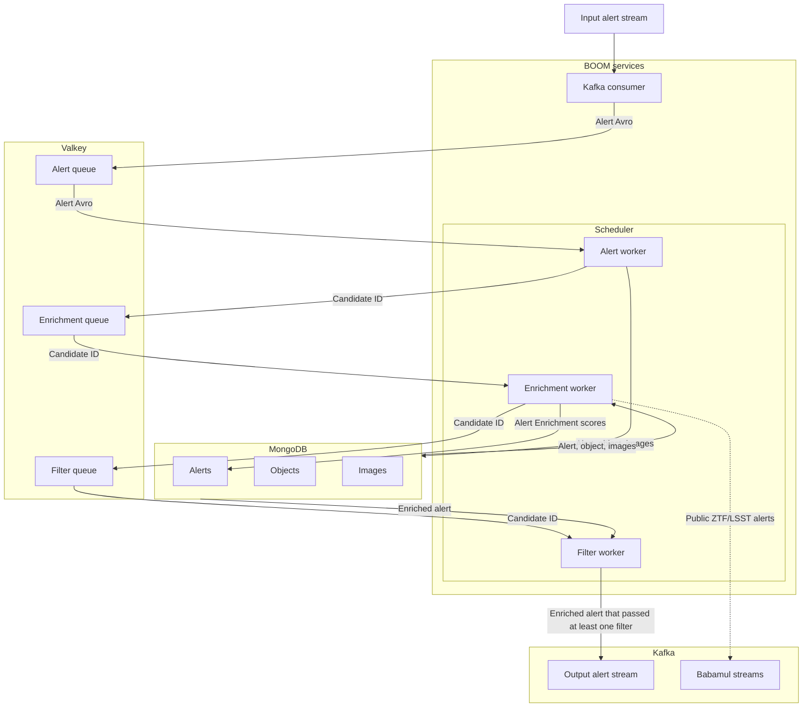

# Alert processing

BOOM consumes Kafka streams of alerts from astronomical surveys
and outputs Kafka streams for consumers like SkyPortal.

Each alert is processed with the following pipeline:

1. Alerts are normalized to unify their schemas as much as possible.
   Their data is split and inserted into an alert dataset,
   an object dataset, and an image dataset, named according to the survey
   with which it is associated.
2. Cross-matches with object IDs from other data catalogs
   (from both live and archival surveys) are added.
   This is done based on the location (right ascension and declination)
   of the object in the alert.
3. Machine learning model classification scores and other properties are added
   to "enrich" the alerts.
4. A set of user-defined filters are applied.
   Any alert that passes through at least one filter is sent
   to a dedicated Kafka output stream for that alert's input stream.

Data flows through the system as follows:

MongoDB serves as the storage, cross-matching, and filtering engine.

When scaling the system to include additional live survey input streams,
each one will have its own:

- Kafka consumer
- Alert queue
- Alert workers
- Enrichment queue
- Enrichment workers
- Filter queue
- Filter workers
- Alert collection
- Object collection
- Image collection
- Output stream

## The enrichment set, and what happens when it changes

The ZTF enrichment worker writes a fixed set of named quantities onto each
alert: the ACAI scores (`acai_h`, `acai_n`, `acai_v`, `acai_o`, `acai_b`),
`btsbot` and the AppleCiDER outputs (`applecider_fusion`, `applecider_outputs`)
under `classifications`, the photometric properties under `properties`, and, on
GPU builds, the Villar light-curve fit under `villar_fit`. The LSST, DECam and
WINTER workers write `properties` only.

Adding a component is only partly detectable after the fact. Outputs that can be
absent are skipped rather than written as null, but a missing key does not prove
that the alert predates the component: `classifications` is left out when the
cutouts cannot be read, and the AppleCiDER keys are also left out for light
curves it does not cover or when inference fails (see
[AppleCiDER](applecider.md#when-the-fields-are-absent)). Selecting on a missing
key alone also picks up every alert the component skipped on purpose, so the
selection has to be limited to alerts enriched before the component was
deployed. Crossmatches do not have this problem: an alert whose `cross_matches`
has no key for a catalog predates that catalog being configured. Pushing the
selected candids onto a reprocessing queue is how a new component is filled in;
`enrich_reprocess` drains that queue, computes the scores and writes them back
without forwarding anything to the filter queue.

Changing a component is not detectable. Nothing records which model version
produced a score, so a retrained model that keeps the same field name leaves no
trace in the document, and an alert scored by the old weights cannot be told
apart from one scored by the new. Re-running after a retrain means selecting the
alerts by some other means, usually a date range.
